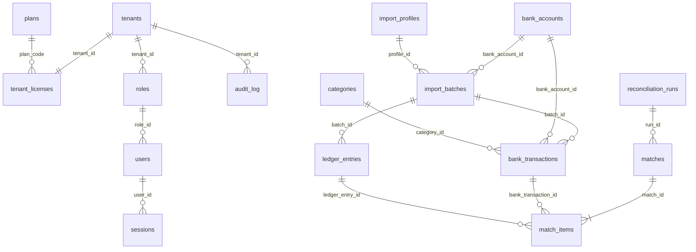

# 03. Modelo de dados

Este documento descreve o esquema do PostgreSQL a partir das migrações em `apps/api/migrations/`:
`0001_base.sql`, `0002_config.sql`, `0003_data.sql`, `0004_functions.sql`, `0005_integrations.sql` e `0006_retention.sql`. Não há migração além da 0006. As migrações 0005 e 0006 não criam tabelas: só acrescentam colunas, restrições, índices e uma função.

O banco tem 31 tabelas públicas: 30 de domínio e `schema_migrations`, a tabela de controle do executor de migrações (`apps/api/src/db/migrate.ts`).

Convenções usadas em todas as tabelas:

- Chaves primárias `uuid` geradas por `gen_random_uuid()`, salvo quando indicado.
- Valores monetários em `bigint` (centavos). Datas civis em `date`. Carimbos de tempo em `timestamptz`.
- Toda tabela de empresa tem `tenant_id`. Quando a tabela tem `UNIQUE (tenant_id, id)`, as ligações entre tabelas usam chave estrangeira composta `(tenant_id, ...)`.
- Colunas `updated_at` são atualizadas por trigger `set_updated_at`.

## Visão geral dos grupos

### Plataforma

Dados da instalação e de cada empresa, administrados pelo operador da plataforma.

| Tabela | Finalidade |
|---|---|
| `tenants` | Empresa cliente, com situação e dados cadastrais. |
| `plans` | Planos comerciais (`essencial`, `profissional`, `corporativo`), com limites e módulos. |
| `tenant_licenses` | Plano e situação da licença de cada empresa. |
| `tenant_modules` | Módulos habilitados por empresa e configuração de cada módulo. |

### Acesso

| Tabela | Finalidade |
|---|---|
| `roles` | Papéis de cada empresa e suas permissões. |
| `users` | Usuários da empresa e operadores da plataforma. |
| `sessions` | Sessões de login. Guarda apenas o hash do token. |

### Configuração

Cadastros e regras de cada empresa, além de integrações e notificações.

| Tabela | Finalidade |
|---|---|
| `tenant_settings` | Documento de configuração da empresa, validado por `packages/core`. |
| `org_nodes` | Unidades, departamentos e centros de custo. |
| `chart_accounts` | Plano de contas. |
| `categories` | Categorias de lançamento, ligadas opcionalmente a uma conta do plano. |
| `bank_accounts` | Contas bancárias da empresa. |
| `import_profiles` | Perfis de mapeamento de arquivos de importação. |
| `classification_rules` | Regras que classificam transações por texto e direção. |
| `report_templates` | Modelos de relatório. |
| `integrations` | Integrações externas. O segredo fica cifrado no campo `secret_ciphertext`. |
| `api_tokens` | Tokens de API para entrada de lançamentos. Guarda apenas o hash. |
| `notification_rules` | Regras que definem quem é avisado de cada evento e por qual canal. |
| `notifications` | Notificações dentro do sistema, por usuário. |
| `notification_deliveries` | Registro de cada tentativa de entrega por e-mail ou webhook. |

### Importação

| Tabela | Finalidade |
|---|---|
| `import_batches` | Lote de importação de um arquivo de extrato ou de lançamentos. |
| `import_files` | Conteúdo original do arquivo, guardado como evidência. |
| `import_rejections` | Linhas rejeitadas de um lote, com o motivo. |

### Dados de origem

Registros recebidos dos arquivos. Os campos de origem não mudam depois de gravados (ver seção própria).

| Tabela | Finalidade |
|---|---|
| `bank_transactions` | Lançamentos do extrato bancário. |
| `ledger_entries` | Lançamentos do sistema financeiro da empresa. |

### Conciliação

| Tabela | Finalidade |
|---|---|
| `reconciliation_runs` | Execução do motor de conciliação para uma conta e um período. |
| `matches` | Decisão de conciliação: sugestão, confirmação, rejeição, desfazimento. |
| `match_items` | Itens (transação do banco ou lançamento) que compõem cada decisão. |

### Fila

| Tabela | Finalidade |
|---|---|
| `jobs` | Trabalhos em segundo plano, com situação, tentativas e último erro. |

### Auditoria

| Tabela | Finalidade |
|---|---|
| `audit_log` | Trilha de auditoria, somente inserção, encadeada por hash em cada empresa. |

## Tabelas

Legenda da coluna RLS: "sim, isolamento padrão" é a política `tenant_isolation`, criada por `_apply_tenant_rls`. Quando a tabela tem política própria, ela está descrita na linha.

### Plataforma

**`tenants`**: empresa cliente.
- Colunas principais: `slug` text (minúsculas, números e hífen, até 50 caracteres, único); `legal_name` e `trade_name` text; `tax_id` text (11 a 14 dígitos, opcional); `status` text (`onboarding`, `active`, `suspended`, `archived`); `onboarding` jsonb.
- Chaves e índices únicos: PK `id`; `UNIQUE (slug)`.
- RLS: sim, política própria. Leitura pela própria empresa ou pela plataforma; inserção só pela plataforma; alteração pela própria empresa ou pela plataforma.
- Trigger `tenants_guard`: fora da plataforma, a empresa não altera `slug` nem `status`, exceto a passagem de `onboarding` para `active`.

**`plans`**: planos comerciais.
- Colunas principais: `code` text (PK, minúsculas); `name`; `description`; `limits` jsonb (`maxUsers`, `maxBankAccounts`, `maxMonthlyTransactions`; nulo significa sem limite); `modules` text[]; `active` boolean.
- Chaves: PK `code`.
- RLS: sim, política própria. Leitura liberada para todos; escrita só pela plataforma.
- Os três planos iniciais são gravados pela própria migração 0001.

**`tenant_licenses`**: licença de cada empresa.
- Colunas principais: `tenant_id` (PK e FK para `tenants`); `plan_code` (FK para `plans`); `status` (`trial`, `active`, `past_due`, `suspended`, `canceled`); `valid_from` e `valid_until` date; `limits_override` jsonb; `external_ref` text (referência em sistema de cobrança externo, quando houver); `notes`.
- Chaves: PK `tenant_id`.
- RLS: sim, política própria. Leitura pela própria empresa ou pela plataforma; escrita só pela plataforma.

**`tenant_modules`**: módulos habilitados por empresa.
- Colunas principais: `tenant_id`; `module_key` text; `enabled` boolean; `config` jsonb; `updated_by` uuid.
- Chaves: PK composta `(tenant_id, module_key)`.
- RLS: sim, política única para todos os comandos: empresa ou plataforma.

### Acesso

**`roles`**: papéis de cada empresa.
- Colunas principais: `key` text (2 a 40 caracteres, minúsculas, números, `_` e `-`); `name`; `description`; `is_system` boolean; `permissions` text[].
- Chaves e índices únicos: PK `id`; `UNIQUE (tenant_id, key)`; `UNIQUE (tenant_id, id)`.
- RLS: sim, isolamento padrão.

**`users`**: usuários.
- Colunas principais: `tenant_id` (nulo apenas para operadores da plataforma); `role_id`; `email` text (formato validado, até 254 caracteres); `name`; `password_hash` text; `status` (`active`, `disabled`); `is_platform_admin`; `must_change_password`; `failed_logins` integer; `locked_until` timestamptz; `password_changed_at`; `last_login_at`.
- Chaves e índices únicos: PK `id`; `UNIQUE (tenant_id, id)`; chave estrangeira composta `(tenant_id, role_id)` para `roles`; **índice único `lower(email)` em toda a instalação**, ou seja, o e-mail é único entre empresas, não só dentro de uma empresa.
- Restrição `users_scope`: operador da plataforma não tem empresa nem papel; usuário de empresa tem empresa e papel.
- RLS: sim, política própria. Leitura pela própria empresa, pelo próprio usuário ou pela plataforma; inserção pela própria empresa ou pela plataforma; alteração pela própria empresa, pelo próprio usuário ou pela plataforma.

**`sessions`**: sessões de login.
- Colunas principais: `user_id`; `tenant_id` (opcional); `token_hash` bytea (SHA-256 do token; o token só existe no cookie); `created_at`; `last_seen_at`; `expires_at`; `idle_minutes` integer (5 a 1440, definido pela empresa no momento do login); `revoked_at`; `revoked_reason`; `ip`; `user_agent`.
- Chaves e índices: PK `id`; `UNIQUE (token_hash)`; índice parcial `sessions_user` em `user_id` onde `revoked_at` é nulo.
- RLS: sim, política própria. Leitura e alteração pelo próprio usuário ou pela empresa; inserção só para o próprio usuário.

### Configuração

**`tenant_settings`**: documento de configuração da empresa.
- Colunas principais: `tenant_id` (PK); `version` integer (incrementado a cada gravação, usado para detectar edição concorrente); `data` jsonb (validado pelo esquema do domínio em `packages/core`); `updated_by`.
- RLS: sim, isolamento padrão.

**`org_nodes`**: unidades, departamentos e centros de custo.
- Colunas principais: `kind` (`unit`, `department`, `cost_center`); `code` (1 a 40); `name`; `parent_id`; `active`.
- Chaves e índices únicos: PK `id`; `UNIQUE (tenant_id, id)`; `UNIQUE (tenant_id, kind, code)`; chave estrangeira composta para o próprio `org_nodes` (hierarquia).
- RLS: sim, isolamento padrão.

**`chart_accounts`**: plano de contas.
- Colunas principais: `code` (1 a 40); `name`; `account_type` (`asset`, `liability`, `equity`, `revenue`, `expense`); `parent_id`; `active`.
- Chaves e índices únicos: PK `id`; `UNIQUE (tenant_id, id)`; `UNIQUE (tenant_id, code)`; chave estrangeira composta para o próprio plano (hierarquia).
- RLS: sim, isolamento padrão.

**`categories`**: categorias de lançamento.
- Colunas principais: `code`; `name`; `kind` (`fee`, `tax`, `interest`, `transfer`, `revenue`, `expense`, `other`); `account_id` (conta do plano de contas, opcional); `active`.
- Chaves e índices únicos: PK `id`; `UNIQUE (tenant_id, id)`; `UNIQUE (tenant_id, code)`.
- RLS: sim, isolamento padrão.

**`bank_accounts`**: contas bancárias da empresa.
- Colunas principais: `name` (1 a 120); `bank_code` (1 a 8 dígitos, opcional); `bank_name`; `branch`; `account_number`; `currency` char(3), padrão `BRL`; `unit_id` (FK composta para `org_nodes`); `ledger_account_id` (FK composta para `chart_accounts`); `external_ref` (como o sistema financeiro identifica a conta nos arquivos de lançamento); `active`.
- Chaves e índices únicos: PK `id`; `UNIQUE (tenant_id, id)`; `UNIQUE (tenant_id, name)`.
- RLS: sim, isolamento padrão.

**`import_profiles`**: perfil de mapeamento de arquivo.
- Colunas principais: `name`; `source_kind` (`bank`, `ledger`); `file_format` (`csv`, `xlsx`); `config` jsonb (obrigatório); `active`.
- Chaves e índices únicos: PK `id`; `UNIQUE (tenant_id, id)`; `UNIQUE (tenant_id, name)`.
- RLS: sim, isolamento padrão.

**`classification_rules`**: regras de classificação.
- Colunas principais: `name`; `priority` integer (0 a 10000, padrão 100); `match_type` (`contains`, `starts_with`, `equals`, `contains_all`); `pattern` (1 a 200); `applies_to` (`bank`, `ledger`, `both`); `direction` (`any`, `credit`, `debit`); `result_kind` (`regular`, `fee`, `tax`, `interest`, `reversal`, `internal_transfer`); `category_id` (FK composta); `active`.
- Chaves: PK `id`; `UNIQUE (tenant_id, id)`.
- RLS: sim, isolamento padrão.

**`report_templates`**: modelos de relatório.
- Colunas principais: `name`; `kind` (`items`, `summary`); `config` jsonb; `is_default`.
- Chaves e índices únicos: PK `id`; `UNIQUE (tenant_id, id)`; `UNIQUE (tenant_id, name)`.
- RLS: sim, isolamento padrão.

**`integrations`**: integrações externas.
- Colunas principais: `kind` (`webhook`, `smtp`, `rest_ledger`, `ai_provider`); `name`; `config` jsonb; `secret_ciphertext` bytea; `secret_key_version` integer; `status` (`not_configured`, `configured`, `verified`, `error`); `last_checked_at`; `last_error`; `active`; `created_by`.
- Chaves e índices únicos: PK `id`; `UNIQUE (tenant_id, id)`; `UNIQUE (tenant_id, name)`.
- RLS: sim, isolamento padrão.
- Regra do domínio: `verified` só é gravado após chamada real bem-sucedida ao serviço externo. Ver `docs/01-requisitos.md`.

**`api_tokens`**: tokens de API.
- Colunas principais: `name`; `token_prefix` text; `token_hash` bytea (SHA-256); `scopes` text[]; `expires_at`; `revoked_at`; `last_used_at`; `created_by`.
- Chaves e índices únicos: PK `id`; `UNIQUE (token_hash)`; `UNIQUE (tenant_id, id)`.
- RLS: sim, isolamento padrão. A busca do token na autenticação é feita pela função `api_token_find` (ver seção de isolamento).

**`notification_rules`**: regras de notificação.
- Colunas principais: `event` text; `channel` (`in_app`, `email`, `webhook`); `target` jsonb (`roleKeys` para dentro do sistema, `emails` para e-mail; no webhook a destinação é a integração); `integration_id` (FK composta para `integrations`); `template` jsonb; `active`.
- Índice parcial `notification_rules_event` (0005) em `(tenant_id, event)` onde `active`, para achar as regras de um evento.
- Chaves: PK `id`; `UNIQUE (tenant_id, id)`.
- RLS: sim, isolamento padrão.

**`notifications`**: notificações dentro do sistema.
- Colunas principais: `user_id`; `event`; `title`; `body`; `link`; `read_at`; `created_at`.
- Chaves e índices: PK `id`; FK composta `(tenant_id, user_id)` para `users`; índice `notifications_user` em `(tenant_id, user_id, created_at DESC)`.
- RLS: sim, isolamento padrão.

**`notification_deliveries`**: tentativas de entrega externa.
- Colunas principais: `rule_id` e `integration_id` (sem chave estrangeira); `channel` (`email`, `webhook`); `event`; `status` (`pending`, `sent`, `failed`, `skipped`); `attempts`; `response_status`; `error`; `payload` jsonb; `sent_at`.
- Chaves e índices: PK `id`; índice `notification_deliveries_tenant` em `(tenant_id, created_at DESC)`.
- RLS: sim, isolamento padrão.

### Importação

**`import_batches`**: lote de importação.
- Colunas principais: `source_kind` (`bank`, `ledger`); `bank_account_id`; `profile_id`; `origin` (`upload`, `api`, `connector`); `idempotency_key` text (0005; 1 a 200 caracteres, opcional); `api_token_id` e `integration_id` (0005; FKs compostas opcionais para `api_tokens` e `integrations`, preenchidas nos lotes vindos da API de entrada e do conector); `file_name`; `file_format` (`ofx`, `csv`, `xlsx`, `json`); `file_sha256` text; `file_size` integer; `status` (`uploaded`, `queued`, `processing`, `completed`, `completed_with_errors`, `failed`, `canceled`); `config` jsonb (mapeamento efetivamente usado, copiado do perfil na confirmação); `stats` jsonb; `error`; `processed_at`; `file_purged_at` timestamptz (0006: momento em que o arquivo original foi removido pelo expurgo por retenção; o lote, o hash e as estatísticas permanecem).
- Chaves e índices únicos: PK `id`; `UNIQUE (tenant_id, id)`; FKs compostas para `bank_accounts`, `import_profiles`, `api_tokens` e `integrations`.
- **Índice único parcial `import_batches_idempotency`** (0005) em `(tenant_id, origin, idempotency_key)`, onde a chave não é nula: a mesma chave de idempotência devolve o mesmo lote.
- **Índice único parcial `import_batches_file_unique`** em `(tenant_id, source_kind, conta, file_sha256)`, onde `status` não é `failed` nem `canceled`. O mesmo arquivo não entra duas vezes para a mesma conta e origem; lotes falhos ou cancelados não contam.
- RLS: sim, isolamento padrão.

**`import_files`**: arquivo original.
- Colunas principais: `batch_id` (PK, sem `id` próprio); `content` bytea; `created_at`.
- Chaves: PK `batch_id`; FK composta para `import_batches`.
- RLS: sim, isolamento padrão.
- O papel da aplicação tem `SELECT`, `INSERT` e `DELETE` nesta tabela, sem `UPDATE`. O expurgo por retenção (`maintenance.purge_import_files`, `apps/api/src/modules/imports/retention.ts`) apaga as linhas de lotes processados há mais dias que `imports.originalFileRetentionDays` (30 a 3650; nulo desliga) e marca `import_batches.file_purged_at`. Ver `docs/08-operacao-backup-recuperacao.md` e `docs/09-seguranca-lgpd.md`.

**`import_rejections`**: linhas rejeitadas.
- Colunas principais: `id` bigint (identidade); `batch_id`; `row_number` integer; `kind` (`invalid`: linha ilegível; `conflict`: identificador já existente com conteúdo diferente); `reason`; `raw` jsonb.
- Chaves e índices: PK `id`; índice `import_rejections_batch` em `(tenant_id, batch_id, row_number)`.
- RLS: sim, isolamento padrão.

### Dados de origem

Os dois registros têm a trigger `source_record_immutable` (ver seção de imutabilidade).

**`bank_transactions`**: lançamentos do extrato.
- Colunas de origem: `bank_account_id`; `batch_id`; `row_number`; `posted_date` date; `amount_cents` bigint (diferente de zero; entrada positiva, saída negativa); `description_raw` e `description_norm`; `external_id`; `document`; `reference`; `identifiers` text[]; `bank_type`; `raw` jsonb; `dedup_key` text; `similarity_key` text.
- Colunas de estado derivado (podem mudar): `kind` (`regular`, `fee`, `tax`, `interest`, `reversal`, `internal_transfer`); `kind_rule`; `category_id`; `recon_status` (`pending`, `reconciled`, `divergent`, `ignored`); `duplicate_suspect` boolean.
- Chaves e índices únicos: PK `id`; `UNIQUE (tenant_id, id)`; **`UNIQUE (tenant_id, bank_account_id, dedup_key)`**, que impede duplicar o mesmo lançamento na mesma conta.
- Índices: `(tenant_id, bank_account_id, posted_date)`; `(tenant_id, recon_status, posted_date)`; `(tenant_id, similarity_key)`; `(tenant_id, batch_id)`.
- RLS: sim, isolamento padrão.

**`ledger_entries`**: lançamentos do sistema financeiro.
- Colunas de origem: `batch_id`; `row_number`; `bank_account_id` (opcional); `entry_date` date; `due_date` date; `amount_cents` bigint (diferente de zero); `description_raw` e `description_norm`; `external_id`; `document`; `reference`; `counterparty`; `cost_center_ref`; `category_ref`; `identifiers` text[]; `raw` jsonb; `dedup_key`; `content_hash`.
- Colunas de estado derivado: `kind`; `recon_status`.
- Chaves e índices únicos: PK `id`; `UNIQUE (tenant_id, id)`; `UNIQUE (tenant_id, dedup_key)`.
- Índices: `(tenant_id, bank_account_id, entry_date)`; `(tenant_id, recon_status, entry_date)`; `(tenant_id, external_id)` parcial, onde `external_id` não é nulo; `(tenant_id, batch_id)`.
- RLS: sim, isolamento padrão.

### Conciliação

**`reconciliation_runs`**: execução do motor.
- Colunas principais: `bank_account_id`; `period_start` e `period_end` date (`period_end >= period_start`); `status` (`queued`, `running`, `completed`, `failed`); `rules_snapshot` jsonb (regras vigentes no momento da execução, obrigatório, para o resultado ser reproduzível); `engine_version`; `stats` jsonb; `error`; `started_by`; `finished_at`.
- Chaves e índices: PK `id`; `UNIQUE (tenant_id, id)`; índice `reconciliation_runs_tenant` em `(tenant_id, created_at DESC)`.
- RLS: sim, isolamento padrão.

**`matches`**: decisão de conciliação.
- Colunas principais: `run_id` (FK composta, opcional); `bank_account_id`; `match_type` (`identifier`, `amount_date`, `tolerance`, `group`, `internal_transfer`, `reversal`, `classification`, `manual`, `ignored`); `status` (`suggested`: aguarda revisão; `pending_approval`: aguarda segunda aprovação; `confirmed`: vigente; `rejected`, `superseded` e `undone`: encerradas); `origin` (`engine`, `user`, `ai`; `ai` foi acrescentado na 0005 para sugestões de classificação de provedor de IA, que nunca são confirmadas sozinhas); `auto_confirmed`; `rule_code`; `engine_version`; `confidence` numeric(5,4); `breakdown` jsonb; `explanation`; `difference_cents` bigint; `date_diff_days` integer; `divergence` (`amount`, `date`, `duplicate`); `ambiguous` boolean; `category_id`; `pair_key` text (identidade do conjunto de itens); campos de proposta, decisão e desfazimento (`proposed_by`, `proposed_at`, `proposal_note`, `decided_by`, `decided_at`, `decision_note`, `undone_by`, `undone_at`, `undo_reason`).
- Chaves e índices: PK `id`; `UNIQUE (tenant_id, id)`; índice `matches_tenant_status` em `(tenant_id, status, created_at DESC)`; índice parcial `matches_pair` em `(tenant_id, pair_key)` onde `status = 'rejected'`, usado para não repetir sugestão já rejeitada; índice `matches_run`. Índice parcial `matches_origin_open` (0005) em `(tenant_id, origin, status)` onde `origin = 'ai'`, para listar sugestões de IA em aberto.
- RLS: sim, isolamento padrão.

**`match_items`**: itens de cada decisão.
- Colunas principais: `id` bigint (identidade); `match_id`; `side` (`bank`, `ledger`); `bank_transaction_id`; `ledger_entry_id`; `active` boolean (verdadeiro enquanto a decisão está vigente ou aguarda aprovação, ou seja, o item fica reservado).
- Restrição: lado `bank` exige `bank_transaction_id` e proíbe `ledger_entry_id`; lado `ledger` faz o inverso.
- Índices únicos parciais: **`match_items_bank_active`** em `(tenant_id, bank_transaction_id)` onde `active`; **`match_items_ledger_active`** em `(tenant_id, ledger_entry_id)` onde `active`. Um item participa de no máximo uma conciliação vigente, e isso garante a exclusão mútua entre decisões concorrentes.
- RLS: sim, isolamento padrão.

### Fila

**`jobs`**: trabalhos em segundo plano.
- Colunas principais: `type`; `payload` jsonb; `idempotency_key`; `status` (`queued`, `running`, `succeeded`, `dead`, `canceled`); `attempts`; `max_attempts` (1 a 20, padrão 3); `run_at`; `locked_at`; `locked_by`; `last_error`; `result` jsonb; `created_by`; `finished_at`.
- Chaves e índices únicos: PK `id`; `UNIQUE (tenant_id, id)`; **`UNIQUE (tenant_id, type, idempotency_key)`**, que faz enfileirar a mesma operação duas vezes resultar em um só trabalho.
- Índices: `jobs_ready` em `(run_at)` onde `status = 'queued'`; `jobs_tenant_status` em `(tenant_id, status, created_at DESC)`.
- RLS: sim, isolamento padrão. O trabalhador não usa essa política para capturar trabalhos: usa a função `jobs_claim`, que atravessa empresas.

### Auditoria

**`audit_log`**: trilha de auditoria. Detalhes na seção "Cadeia de auditoria".
- Colunas principais: `id` bigint (identidade); `tenant_id` (nulo para eventos da plataforma); `seq` bigint (posição na cadeia da empresa); `occurred_at`; `actor_type` (`user`, `system`, `api_token`, `platform`); `actor_id`; `actor_label` (nome do autor no momento do evento); `action`; `entity_type`; `entity_id`; `summary`; `before`, `after` e `metadata` jsonb; `request_id`; `ip`; `prev_hash` bytea; `hash` bytea.
- Chaves e índices: PK `id`; **índice único `audit_log_chain`** em `(coalesce(tenant_id, zero uuid), seq)`; índice `audit_log_tenant_time` em `(tenant_id, occurred_at DESC)`; índice `audit_log_entity` em `(tenant_id, entity_type, entity_id)`.
- RLS: sim, com duas políticas: leitura e inserção pela empresa do contexto ou, para eventos sem empresa, pela plataforma.
- Não há política de alteração nem de exclusão, e triggers bloqueiam `UPDATE`, `DELETE` e `TRUNCATE`.

### Controle de migrações

**`schema_migrations`**: tabela criada por `apps/api/src/db/migrate.ts`, não por arquivo SQL.
- Colunas: `name` (nome do arquivo), `checksum` (64 caracteres hexadecimais) e `applied_at`.
- Sem RLS. O papel da aplicação tem apenas `SELECT`, concedido pelo executor. `/readyz` compara a última migração aplicada com a esperada.

## Isolamento por empresa

### Como o contexto chega ao banco

Toda consulta de empresa roda em `withContext(pool, {tenantId, ...})`. Esse contexto define três variáveis de sessão da transação, com `set_config(..., true)`:

- `app.tenant_id`: empresa do pedido.
- `app.user_id`: usuário autenticado.
- `app.platform`: `on` quando a operação é da plataforma.

As funções `app_tenant_id()`, `app_user_id()` e `app_is_platform()` leem essas variáveis. Se o contexto não foi definido, `app_tenant_id()` devolve nulo, e nenhuma linha de tabela de empresa passa pela política. Por isso a falha é fechada: esquecer o contexto resulta em nenhum dado, não em dados de outra empresa.

### Políticas

- **Isolamento padrão** (`_apply_tenant_rls`): cria a política `tenant_isolation` com `USING (tenant_id = app_tenant_id())` e a mesma condição em `WITH CHECK`. Vale para leitura, inserção, alteração e exclusão. Essa política não inclui a plataforma: operador da plataforma não lê tabela de empresa sem passar pelas tabelas com política própria.
- **Políticas próprias**: `tenants`, `plans`, `tenant_licenses`, `tenant_modules`, `users`, `sessions` e `audit_log` têm regras específicas, descritas acima, porque precisam atender à plataforma ou ao próprio usuário.
- **Recurso de outra empresa**: a linha não é visível. A consulta devolve zero linhas, e a API responde 404.

### Chaves compostas

Toda ligação entre tabelas de empresa usa `(tenant_id, id)`. Exemplo: `bank_transactions` referencia `bank_accounts` por `(tenant_id, bank_account_id)`. Mesmo que um erro de código tente ligar um registro a outra empresa, o banco recusa a chave estrangeira.

### Papéis do banco

- `concilia_owner`: dono do esquema. Usado só para migrações e backup. Como dono, não está sujeito a RLS por padrão do PostgreSQL.
- `concilia_app`: papel da aplicação, criado com `NOSUPERUSER NOBYPASSRLS`, sem ser dono de objetos. Está sujeito a RLS. Criado por `ops/db-bootstrap.sh`.

### Funções `SECURITY DEFINER`

Estas funções rodam com os privilégios do dono do esquema. Todas têm `SET search_path = public, pg_temp`. Na migração 0004, foram revogadas de `PUBLIC` e concedidas só a `concilia_app`; a `maintenance_retention_tenants()` (0006) recebe o mesmo tratamento.

| Função | Por que existe |
|---|---|
| `app_tenant_id()`, `app_user_id()`, `app_is_platform()` | Leitura do contexto. Não são `SECURITY DEFINER`; apenas leem variáveis de sessão. |
| `set_updated_at()`, `_apply_tenant_rls()`, `tenants_guard()`, `source_record_immutable()` | Funções de trigger ou de criação de esquema. Não são `SECURITY DEFINER`. |
| `audit_log_chain()` (trigger, 0001) | `SECURITY DEFINER`. Precisa ler a última linha da cadeia da empresa independentemente do contexto e obter o bloqueio consultivo da cadeia. |
| `auth_find_user(email)` | Login acontece antes de haver contexto. Localiza o usuário pelo e-mail e devolve o hash da senha para comparação. |
| `auth_register_login_failure(...)`, `auth_register_login_success(...)` | Contam falhas e bloqueiam a conta antes de haver contexto. |
| `auth_find_session(token_hash)` | Resolve o cookie em sessão, usuário e papel antes de haver contexto. |
| `api_token_find(token_hash)` | Resolve o token de API em empresa e escopos antes de haver contexto. |
| `jobs_claim(worker, limit)` | O trabalhador pega trabalhos de qualquer empresa, com `FOR UPDATE SKIP LOCKED`. Depois executa cada trabalho no contexto da empresa dona. |
| `jobs_release_stale(timeout)` | Devolve à fila, ou encerra como `dead`, trabalhos travados de qualquer empresa. |
| `maintenance_retention_tenants()` (0006) | Devolve só os ids das empresas com `imports.originalFileRetentionDays` numérico em `tenant_settings`. O trabalhador usa a lista para agendar, uma vez por dia, o expurgo de arquivos de cada empresa; o trabalho em si roda no contexto da própria empresa. |
| `ops_queue_stats()` | Apenas contagens por situação da fila, para as métricas. Não expõe conteúdo de empresa. |

Como essas funções atravessam empresas, a concessão é a parte sensível. Por isso são poucas, de escopo estreito e sem parâmetro de empresa livre, exceto `auth_find_*` e `api_token_find`, que recebem uma chave de busca (e-mail ou hash).

`audit_verify_chain(p_tenant)` não é `SECURITY DEFINER`. Roda com os privilégios de quem chama e, por isso, respeita RLS.

## Imutabilidade dos registros de origem

`bank_transactions` e `ledger_entries` têm a trigger `source_record_immutable`, em `BEFORE UPDATE OR DELETE`, por linha.

- `DELETE` é recusado em qualquer caso.
- `UPDATE` é aceito só se as colunas de origem forem idênticas. A trigger compara o registro antigo e o novo sem as colunas de estado (`kind`, `kind_rule`, `category_id`, `recon_status`, `duplicate_suspect`). Se qualquer coluna de origem mudar, a operação é recusada.
- Em `ledger_entries`, a mesma lista é usada. Como essa tabela não tem `kind_rule`, `category_id` nem `duplicate_suspect`, só `kind` e `recon_status` podem mudar.

Limites conhecidos:

- A trigger é por linha. `TRUNCATE` não passa por ela. Hoje a proteção contra `TRUNCATE` depende de privilégio: o papel `concilia_app` não recebe `TRUNCATE` (ver as concessões na migração 0003).
- O dono do esquema pode remover ou desabilitar a trigger. A proteção depende de restringir o acesso ao papel `concilia_owner`.

## Cadeia de auditoria

Cada evento de `audit_log` é encadeado ao anterior da mesma empresa. Eventos da plataforma (sem `tenant_id`) formam uma cadeia própria, identificada pelo UUID zero.

Gravação:

1. A trigger `audit_log_chain`, `BEFORE INSERT`, obtém um bloqueio consultivo por cadeia (`pg_advisory_xact_lock`). Assim, uma inserção por vez em cada cadeia.
2. Lê o último `seq` e `hash` da cadeia e atribui `seq` igual ao último mais um, e `prev_hash` igual ao último `hash`.
3. Redefine `occurred_at` com `clock_timestamp()`, para que o carimbo entre no hash.
4. Calcula `hash = sha256` da concatenação, separada por `0x1F`, de: `prev_hash` em hexadecimal, `seq`, `tenant_id`, `occurred_at` em UTC, tipo e identificador do autor, rótulo do autor, ação, tipo e identificador da entidade, resumo, `before`, `after`, `metadata`, `request_id` e `ip`.

Cada alteração de um campo gravado muda o hash daquele evento e quebra o encadeamento com o seguinte.

Verificação: `audit_verify_chain(tenant)` percorre a cadeia em ordem de `seq`, recalcula cada hash e confere se `seq` é contínuo e se `prev_hash` aponta para o hash anterior. Devolve `checked`, `broken_seq` (nulo se íntegra), `head_seq` e `head_hash`. A CLI `audit:verify --tenant <slug>` ou `--platform` usa essa função e sai com código 2 se a cadeia estiver quebrada.

Imutabilidade: as triggers `audit_log_no_change` (`UPDATE` e `DELETE`) e `audit_log_no_truncate` (`TRUNCATE`) recusam qualquer alteração, para qualquer papel que passe por elas.

Limite: a verificação compara linhas entre si. Se a última linha de uma cadeia for apagada, o restante continua consistente e a função não acusa a perda. Para detectar esse caso é preciso guardar o `head_hash` fora do banco. O repositório não tem esse registro externo.

## Diagrama de relacionamentos

Apenas as tabelas e ligações principais.

