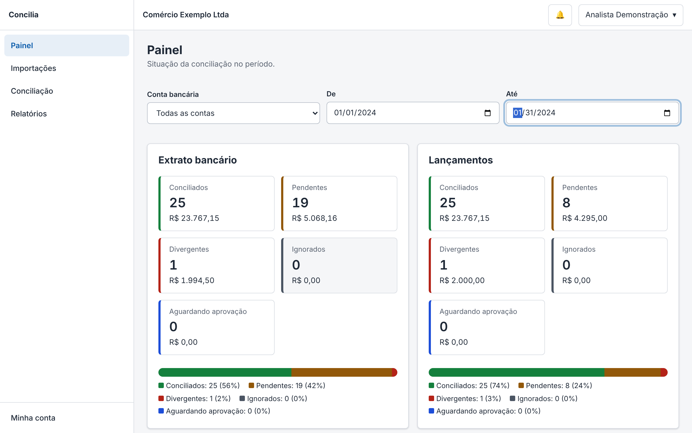
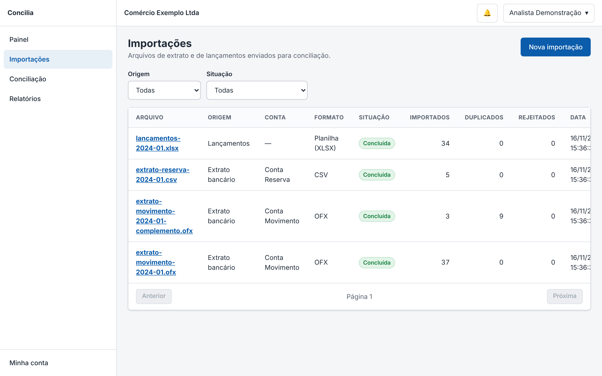
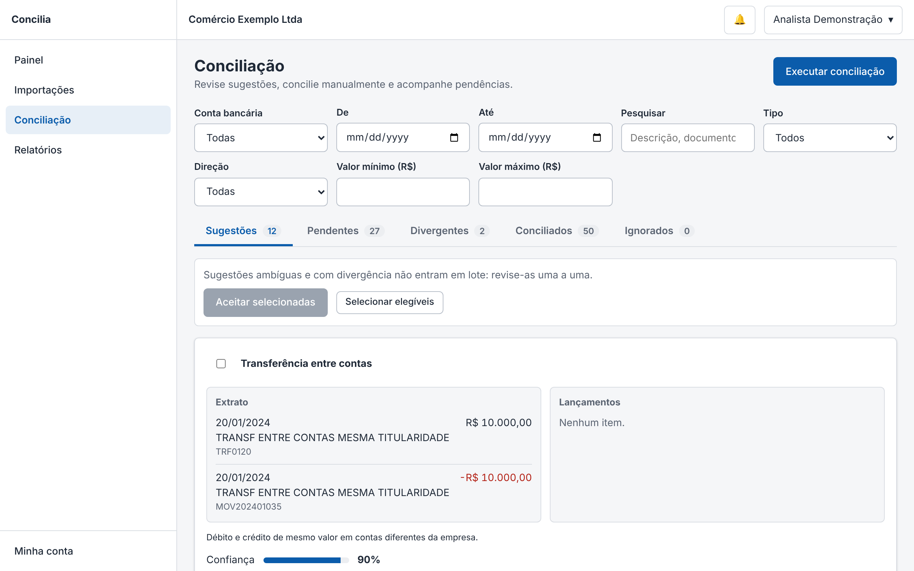

# Manual do administrador

Este manual explica o uso do Concilia no dia a dia. Ele serve para o administrador da empresa cliente e para a equipe de implantação do fornecedor. Não é preciso saber programar.

Os nomes de menus, botões e campos aparecem aqui exatamente como na tela. O que você vê depende do seu papel: menus e botões sem permissão não aparecem ou ficam desabilitados (veja a seção 10).

Para adaptar o produto a uma empresa nova (regras, perfis de importação, planos), use o `07-manual-de-personalizacao.md`.

## Sumário

1. O que o Concilia faz e o que não faz
2. Primeiro acesso e troca de senha
3. Visão geral da tela e painel
4. Importar extratos e lançamentos
5. Executar a conciliação
6. Entender o resultado
7. Revisar: aceitar, rejeitar, conciliar manualmente, classificar, ignorar, desfazer
8. Aprovação em duas etapas
9. Relatórios e exportações
10. Usuários, papéis e permissões
11. Minha conta e sessões
12. Auditoria e verificação de integridade
13. Avisos internos
14. Perguntas frequentes e problemas comuns

---

## 1. O que o Concilia faz e o que não faz

O Concilia compara o extrato do banco com os lançamentos do sistema financeiro da empresa. Ele sugere ou confirma os pares que correspondem e registra cada decisão com data, autor e motivo.

Ele **não** conecta em bancos, **não** movimenta dinheiro e **não** escreve no sistema financeiro. Os arquivos de extrato e de lançamentos entram por importação. O que precisa ser lançado no sistema de origem sai em um relatório (seção 9).

Os dados originais importados nunca são alterados. Toda decisão fica registrada à parte e pode ser desfeita.

## 2. Primeiro acesso e troca de senha

Quem cria a empresa (o operador da plataforma, que é da equipe do fornecedor) cadastra o primeiro administrador. A senha temporária aparece uma única vez para o operador, que deve entregá-la a você por um canal seguro.

**Para entrar pela primeira vez**

1. Abra o endereço do Concilia no navegador.
2. Na tela **Entrar**, preencha **E-mail** e **Senha** (a senha temporária).
3. Clique em **Entrar**.
4. O sistema abre a tela **Trocar senha** com a mensagem "Sua senha é temporária. Defina uma nova senha para continuar."
5. Preencha **Senha atual** (a temporária), **Nova senha** e **Confirmar nova senha**.
6. Salve. Aparece "Senha alterada com sucesso."

Regras da nova senha:

- Tamanho mínimo: 10 caracteres, a menos que a empresa tenha mudado isso em **Configurações > Segurança** (de 8 a 64).
- Não pode ser igual à senha atual.
- Não pode ser repetitiva demais (poucos caracteres diferentes).
- Não pode conter a parte do seu e-mail antes do "@" (quando ela tem 4 letras ou mais).

Depois de várias tentativas erradas de senha a partir do mesmo computador ou rede (padrão: 5), quem errou precisa esperar antes de tentar de novo: 30 segundos, dobrando a cada nova falha, até 15 minutos. A espera vale só para aquela origem: o titular continua entrando normalmente de outro lugar, para que ninguém consiga travar a conta de outra pessoa errando a senha de propósito. A senha temporária vence em 72 horas. Esses números são da instalação, não da empresa (veja o manual de personalização).

Para sair, use o menu com o seu nome, no canto superior direito, e clique em **Sair**.

**Se a empresa ainda está em implantação**, aparece uma faixa no topo: "A implantação da empresa ainda não foi concluída." com o link **Continuar a implantação**. Quem conclui a implantação é o administrador (veja o `07-manual-de-personalizacao.md`).

## 3. Visão geral da tela e painel

A tela tem três partes:

- **Menu lateral**, à esquerda: Painel, Importações, Conciliação, Aprovações (só com o módulo ativo e a permissão), Relatórios, Auditoria, Configurações e Implantação. No fim do menu fica **Minha conta**. No celular, o menu vira uma gaveta aberta pelo botão "Abrir menu".
- **Barra superior**: nome da empresa, o sino de **Avisos** e o menu do usuário (**Minha conta** e **Sair**).
- **Área de trabalho**, onde abre cada tela.

Se a licença da empresa estiver em somente leitura, aparece uma faixa "Licença em somente leitura" e os botões que alteram dados ficam desabilitados (seção 14).

### O painel

O **Painel** mostra a "Situação da conciliação no período".

1. Use os filtros **Conta bancária** (padrão "Todas as contas"), **De** e **Até** para escolher o recorte. A data inicial não pode ser posterior à final.
2. Veja os dois blocos, **Extrato bancário** e **Lançamentos**. Cada um mostra quantidade e valor por situação:
   - **Conciliados** (verde): já têm par decidido.
   - **Pendentes** (âmbar): ainda sem decisão.
   - **Divergentes** (vermelho): há diferença de valor ou de data, ou possível duplicidade, e alguém precisa decidir.
   - **Ignorados** (cinza): alguém decidiu que não precisam de par.
   - **Aguardando aprovação** (azul): decisão tomada que depende de uma segunda pessoa.
3. Abaixo ficam os indicadores: **Sugestões aguardando revisão** (link **Revisar sugestões**), **Aprovações pendentes** (link **Ver aprovações**, para quem pode aprovar) e **Conciliação automática** (percentual de itens conciliados pelo motor sem intervenção).
4. Em **Última importação** e **Última execução** você vê as atividades mais recentes.
5. A tabela **Por conta bancária** mostra quantidade e valor por situação em cada conta. Clicar numa célula abre a Conciliação já filtrada.

Em uma empresa sem dados, o painel mostra "Comece importando seus arquivos", com os botões **Importar arquivos** e **Executar conciliação**.

## 4. Importar extratos e lançamentos

Formatos aceitos:

| Origem | Formatos |
|---|---|
| **Extrato bancário** | OFX, CSV, XLSX |
| **Lançamentos** | CSV, XLSX |

(Lançamentos também podem chegar por API ou por conector REST, quando a empresa usa esses módulos. Veja o manual de personalização.)

O tamanho máximo do arquivo e o número máximo de linhas são limites da instalação (padrão: 15 MB e 100.000 linhas).

### 4.1 Passo a passo

1. No menu, clique em **Importações** e depois em **Nova importação**. A tela mostra "Passo 1 de 3: Arquivo".
2. Em **Origem**, escolha **Extrato bancário** ou **Lançamentos**.
3. Em **Conta bancária**, escolha a conta do extrato. É obrigatória para extrato e opcional para lançamentos.
4. Se for CSV ou XLSX e a empresa já tiver um perfil para esse layout, escolha-o em **Perfil de importação (opcional)**. Sem perfil, o sistema tenta adivinhar as colunas.
5. Clique em **Selecionar arquivo** e escolha o arquivo.
6. Clique em **Enviar e pré-visualizar**. Nada é importado ainda.

### 4.2 Pré-visualização de arquivo OFX

No "Passo 2 de 3: Pré-visualização e mapeamento" você vê a conta do arquivo, o período, o número de transações e uma amostra.

- Se aparecer **inválidas**, algumas transações do arquivo têm problema e serão rejeitadas.
- **Aviso de conta divergente**: se a conta que consta no arquivo não corresponde à conta bancária escolhida, aparece "A conta do arquivo não corresponde à conta bancária selecionada." com a conta lida do arquivo. O botão **Confirmar importação** fica bloqueado. Confira se escolheu a conta certa (volte com **Cancelar importação** e comece de novo). Só marque **Importar mesmo assim** se tiver certeza.

### 4.3 Pré-visualização e mapeamento de CSV e XLSX

Aparece a amostra das primeiras linhas e o número de linhas de dados. Em planilhas com mais de uma aba, escolha a **Aba da planilha**.

Um aviso amarelo explica a origem do mapeamento: o do perfil escolhido ou "uma sugestão heurística, feita a partir dos nomes das colunas". Se o sistema não identificou alguma coluna, o aviso diz "Não foi possível identificar: ...". **Confira cada campo antes de confirmar.**

O editor de mapeamento tem quatro blocos:

- **Leitura do arquivo**: **Delimitador** (só CSV), **Codificação** (só CSV; se os acentos saírem trocados, escolha Windows-1252), **Aba da planilha** (só XLSX), **Linha do cabeçalho** (0 = arquivo sem cabeçalho, e as colunas passam a ser indicadas por #1, #2...), **Formato de data** e **Separador decimal**.
- **Valor**: **Como o valor aparece**, com três opções: "Uma coluna, com sinal"; "Colunas de débito e crédito"; "Valor e coluna de tipo". A caixa **Inverter o sinal** serve para arquivos que mostram as saídas como positivas (como fatura de cartão).
- **Colunas**: **Data**, **Valor** (ou **Débito (saída)** e **Crédito (entrada)**, ou **Valor** e **Tipo (entrada/saída)**), **Descrição** (até 5 colunas, unidas num texto só) e os opcionais **Identificador**, **Documento**, **Referência**, **Favorecido**, **Vencimento**, **Conta**, **Centro de custo** e **Categoria**. O **Identificador** é o que mais ajuda a conciliar sem dúvida.
- **Linhas a ignorar**: **Textos de linhas a ignorar**, um por linha. Linhas cuja descrição começa com um deles (por exemplo SALDO ANTERIOR) não viram transações.

Para reaproveitar o mapeamento, marque **Salvar como perfil de importação** e preencha **Nome do perfil**.

Campos obrigatórios que faltarem ficam com a mensagem "Informe a coluna."

### 4.4 Confirmar e acompanhar

1. Clique em **Confirmar importação**. (Para desistir, **Cancelar importação**: o arquivo enviado é descartado e nada é importado.)
2. No "Passo 3 de 3: Processamento", o sistema mostra "Aguardando na fila…" ou "Processando o arquivo…". Você pode sair da tela; o andamento fica em **Importações**.
3. Ao terminar, aparece o **Resultado** com **Importados**, **Duplicados**, **Rejeitados** e, se houver, **Conflitos**, e o link **Ver detalhes do lote**.

A situação do lote pode ser: **Aguardando confirmação**, **Na fila**, **Processando**, **Concluída**, **Concluída com rejeições**, **Falhou** ou **Cancelada**.

### 4.5 Arquivo duplicado

- **Mesmo arquivo enviado duas vezes** para a mesma conta: o envio é recusado com "Este arquivo já foi importado para esta conta." e o link **Ver o lote existente**.
- **Arquivos que se sobrepõem** (por exemplo, um extrato de janeiro e outro de 25/01 a 05/02): o sistema reconhece as transações repetidas e **não as grava de novo**. Elas aparecem no contador **Duplicados**. Isso é normal e seguro.
- **Possível duplicidade**: se uma transação nova tem a mesma conta, data, valor e descrição de outra já importada em outro lote, ela entra marcada como **Possível duplicidade** e fica **Divergente**. Você decide (seção 6.5).

### 4.6 Ler as rejeições

Abra **Importações** e clique no nome do arquivo. A tela do lote mostra os números (**Linhas lidas**, **Importados**, **Duplicados**, **Rejeitados**, **Conflitos**, **Ignorados**, **Suspeitas de duplicidade**) e, em **Rejeições**, uma tabela com **Linha**, **Tipo**, **Motivo** e **Dados brutos**. Dá para filtrar por **Tipo**.

- **Inválida**: a linha não pôde ser lida. Motivos comuns: "Linha sem data", "Data inexistente", "Formato de data não reconhecido", "Linha sem valor", "Valor não numérico", "Valor com mais de duas casas decimais", "Valor ambíguo: defina o separador decimal no perfil de importação", "Linha com débito e crédito preenchidos", "Tipo não reconhecido".
- **Conflito** (só lançamentos): o mesmo identificador apareceu com conteúdo diferente. Exemplos: "Identificador ... repetido no arquivo com conteúdo diferente." e "Lançamento ... já importado com conteúdo diferente; o registro existente foi mantido." O registro antigo não é alterado.

Para corrigir, ajuste o arquivo e importe de novo (as linhas já aceitas não duplicam), ou ajuste o mapeamento e use **Reprocessar** (disponível para lotes concluídos ou que falharam). O reprocessamento lê o arquivo original com o mesmo mapeamento.

Se aparecer o bloco **Trabalho na fila** com a situação **Falha definitiva**, clique em **Tentar de novo**.

## 5. Executar a conciliação

Quem tem a permissão "Executar a conciliação" vê o botão **Executar conciliação** na tela **Conciliação** (e no painel).

1. Clique em **Executar conciliação**.
2. Escolha a **Conta bancária** (obrigatória).
3. Informe **Início do período** e **Fim do período**. O período pode ter no máximo 366 dias, e o fim não pode ser anterior ao início.
4. Clique em **Executar**.
5. Aguarde "Na fila, aguardando execução…" e depois "Conciliando…".
6. Ao final aparece "Conciliação concluída." com três números: **Conciliados automaticamente**, **Sugestões para revisar** e **Divergências**.
7. Clique em **Fechar**. Se não quiser esperar, use **Fechar e acompanhar depois**.

Se aparecer "A execução falhou.", veja a seção 14.

Rodar de novo no mesmo período é seguro. Itens já conciliados não são tocados, e pares que você rejeitou antes não voltam a ser sugeridos.

## 6. Entender o resultado

A tela **Conciliação** tem cinco abas, com a contagem de cada uma: **Sugestões**, **Pendentes**, **Divergentes**, **Conciliados** e **Ignorados**. Os filtros no alto são **Conta bancária**, **De**, **Até**, **Pesquisar** (descrição, documento, identificador), **Tipo**, **Direção** (**Entradas** ou **Saídas**), **Valor mínimo (R$)** e **Valor máximo (R$)**. **Limpar filtros** zera tudo.

### 6.1 Conciliado automaticamente

É um par confirmado pelo motor, sem intervenção humana. Só acontece quando uma regra de confirmação automática, ativada pela empresa, é satisfeita sem nenhuma dúvida. Na aba **Conciliados**, abra o item para ver o histórico: aparece "Conciliado automaticamente" com o autor "Motor de conciliação" e a **Regra** aplicada. **A percentagem de confiança nunca decide a conciliação automática.** Só as regras decidem.

### 6.2 Sugestão

É um par provável que aguarda a sua decisão. Cada cartão mostra o nome da regra, o lado **Extrato** e o lado **Lançamentos**, uma explicação em texto, a **Confiança** e os botões **Aceitar**, **Rejeitar** e **Detalhe**. A confiança é só uma ajuda para ordenar e explicar. Ela é calculada com estes pesos: valor 35%, data 15%, identificador 20%, descrição 10% e unicidade (poucos concorrentes) 20%. O **Detalhe** mostra essa "Decomposição da confiança".

### 6.3 Ambígua

Selo **Ambígua**: existe mais de um candidato possível para o mesmo item (ou mais de uma combinação, no caso de agrupamento). O sistema nunca escolhe sozinho: mostra as opções e você decide. Sugestões ambíguas não entram na aceitação em lote.

### 6.4 Divergente

Selo vermelho **Divergência**, com o tamanho da diferença, por exemplo "valor +R$ 5,00" ou "2 dias". Significa que o par provável tem diferença de valor ou de data. Itens nessa situação ficam na aba **Divergentes**. Também não entram em lote.

### 6.5 Possível duplicidade

Selo **Divergência: possível duplicidade**. Uma transação nova parece ser repetição de outra já importada (mesma conta, data, valor e descrição). A sugestão é tratá-la como duplicada e ignorá-la. Compare as duas e decida: **Aceitar** (a transação nova é ignorada) ou **Rejeitar** (ela é mantida, pois é uma transação real e distinta, como duas vendas idênticas no mesmo dia).

### 6.6 As regras do motor

O motor aplica as regras na ordem da tabela. Cada item só entra num par. "Candidato único" quer dizer que não existe nenhum outro lançamento (nem outro item do extrato) competindo pelo mesmo par. Valores em "tolerância" são os que a empresa configurou em **Configurações > Regras e tolerâncias**.

| Nome na tela | Quando acontece | O que o sistema faz |
|---|---|---|
| **Identificador e valor** | Os dois lados têm o mesmo identificador (documento, ID da transação ou número extraído da descrição) e o mesmo valor, com datas dentro do "Limite de dias para identificador". | Com candidato único e a opção **Por identificador** ligada: **confirma sozinho**. Com vários candidatos: sugestão **ambígua**. Também vira sugestão se um candidato já foi rejeitado antes. |
| **Identificador e valor, data fora do limite** | Mesmo identificador e mesmo valor, mas as datas estão mais afastadas que o limite. | **Sugestão** com divergência de data. Nunca confirma sozinho. |
| **Identificador igual, valor diferente** | Mesmo identificador, de mesmo sinal, mas valores diferentes. | **Sugestão** com divergência de valor, mostrando a diferença. Nunca confirma sozinho. |
| **Valor, data e descrição** | Mesmo valor, **mesma data** e descrição parecida (semelhança de pelo menos 50%), candidato único. | Com **Por valor, data e descrição** ligada: **confirma sozinho**. Senão, sugestão. |
| **Valor e data, candidato único** | Mesmo valor e datas dentro da "Tolerância de data", candidato único, sem coincidir a descrição. | Com **Por candidato único** ligada: **confirma sozinho**. Senão, sugestão. |
| **Valor e data, vários candidatos** | Mesmo valor e data dentro da tolerância, mas com mais de um candidato. | **Sugestão ambígua**, até o limite de "Máximo de sugestões por item". |
| **Valor dentro da tolerância** | Valores diferentes, mas a diferença cabe na "Tolerância de valor" (em reais ou em percentual, vale a maior) e a data está dentro da tolerância. Só funciona se a tolerância de valor for maior que zero. | **Sugestão** com divergência de valor. Nunca confirma sozinho. |
| **Agrupamento de itens** | Um item de um lado é igual à **soma de 2 ou mais itens** do outro lado (por exemplo, um depósito que reúne vários recebimentos). Exige o módulo Agrupamento e que a opção esteja ligada. | **Sugestão**, com confiança limitada a 90%. Se existir mais de uma combinação possível, fica **ambígua**. |
| **Transferência entre contas** | Um débito e um crédito de **mesmo valor** em **contas diferentes** da empresa, dentro da "Tolerância de data da transferência", em que pelo menos um deles foi reconhecido como "Transferência interna". Exige o módulo Transferências internas. | **Sugestão**. Só confirma sozinho se **Transferências internas** estiver ligada, os dois lados forem reconhecidos como transferência e o par for único. |
| **Estorno** | Uma transação reconhecida como "Estorno" tem valor oposto ao de outra transação da **mesma conta**, que veio antes dela dentro da "Janela de estorno". | Sempre **sugestão**. |
| **Classificação por regra** | Uma transação do extrato é reconhecida como tarifa, imposto ou juros e não tem lançamento correspondente. | Com **Tarifas** ligada: confirma sozinho como classificação. Senão, **sugestão** para você aceitar. |

Outras regras de comportamento:

- **Um pedido rejeitado não volta.** Se você rejeita uma sugestão, o par não é mais proposto. O candidato que sobrou também passa por revisão: não é confirmado sozinho.
- **Sugestões abaixo da "Confiança mínima"** (padrão 30%) não aparecem.
- **Aceitar uma sugestão** pode exigir aprovação de uma segunda pessoa, conforme as regras de aprovação (seção 8).

## 7. Revisar

Quem tem a permissão "Revisar sugestões e propor conciliações" faz as ações abaixo. Quem só consulta vê as telas, sem botões.

### 7.1 Aceitar

- **Uma sugestão:** na aba **Sugestões**, clique em **Aceitar**. Aparece "Sugestão aceita." Se a decisão exigir aprovação, a mensagem é "Decisão registrada: aguarda aprovação de outra pessoa."
- **Várias de uma vez:** marque as caixas das sugestões, ou clique em **Selecionar elegíveis** (só sugestões sem ambiguidade e sem divergência), e clique em **Aceitar selecionadas**. Ao final aparece o "Resultado do lote" com o que foi aceito e o que falhou, e por quê. **Limpar** desfaz a seleção.

Se alguém já tiver conciliado os mesmos itens por outra decisão, o sistema avisa "Os itens já foram conciliados por outra decisão. A lista foi recarregada."

### 7.2 Rejeitar

1. Em um cartão, clique em **Rejeitar**.
2. No diálogo "Rejeitar sugestão" (aviso: "O par não será proposto novamente."), escreva o **Motivo**. É obrigatório.
3. Clique em **Rejeitar**.

### 7.3 Conciliar manualmente

Nas abas **Pendentes** e **Divergentes** aparecem duas listas, **Extrato** e **Lançamentos**.

1. Marque as caixas dos itens que formam o par (pelo menos um de cada lado, no máximo 50 de cada).
2. Uma barra fixa mostra a soma de cada lado e a **Diferença**.
3. Se houver diferença, preencha a **Nota (obrigatória com diferença)** explicando.
4. Clique em **Conciliar selecionados**. Aparece "Conciliação manual registrada." (ou o aviso de que aguarda aprovação).
5. **Limpar seleção** cancela.

Clicar em uma linha abre o **Detalhe do item**, com todos os dados, a "Linha bruta" original e o "Histórico de decisões".

### 7.4 Classificar tarifa (e outras transações sem lançamento)

Para itens do extrato que não têm lançamento, como tarifas, impostos e juros:

1. Na linha do item (aba **Pendentes** ou **Divergentes**), clique em **Classificar**.
2. No diálogo "Classificar transação", escolha a **Categoria** (obrigatória) e, se quiser, uma **Observação**.
3. Clique em **Classificar**. Aparece "Transação classificada."

Depois, o relatório **Lançamentos a criar** (seção 9) lista essas classificações para a equipe lançar no sistema financeiro.

### 7.5 Ignorar

Use para itens que não precisam de par.

1. Na linha do item, clique em **Ignorar**.
2. No diálogo "Ignorar item" ("o item sai da fila de pendências"), escreva o **Motivo**, que é obrigatório.
3. Clique em **Ignorar**. Aparece "Item ignorado."

### 7.6 Desfazer

Quem tem a permissão "Desfazer conciliações" pode desfazer pares confirmados e itens ignorados.

1. Na aba **Conciliados** ou **Ignorados**, clique em **Desfazer** na linha. (Também há **Desfazer** no detalhe de uma conciliação confirmada.)
2. No diálogo "Desfazer conciliação" ("... voltará para pendente."), escreva o **Motivo**.
3. Clique em **Desfazer**. Aparece "Conciliação desfeita."

O histórico guarda a conciliação original, o desfazimento, quem fez e o motivo. Nada é apagado.

## 8. Aprovação em duas etapas

Esta função depende do módulo **Aprovação em duas etapas** (plano e ativação em **Configurações > Módulos**) e de configuração própria.

### 8.1 Configurar (administrador)

Em **Configurações > Aprovações**:

1. Marque **Exigir aprovação em duas etapas**.
2. Mantenha marcada **Quem propõe não aprova** (recomendado). Sem ela, a aprovação perde o efeito de controle.
3. Em **Operações que exigem aprovação**, escolha: **Conciliação manual**, **Conciliação com diferença de valor**, **Itens com mais de uma possibilidade**, **Conciliação em grupo**, **Classificação de itens**, **Ignorar itens**. Os padrões são: manual, diferença de valor e ignorar ligados.
4. Clique em **Salvar alterações**.

Se o módulo não estiver ativo, as opções ficam desabilitadas e a tela avisa.

### 8.2 Aprovar ou recusar (gestor)

Quem tem a permissão "Aprovar conciliações pendentes de aprovação" vê **Aprovações** no menu, com a contagem de pendentes. Ao surgir uma nova, essas pessoas recebem um aviso no sino: "Conciliação aguardando aprovação".

1. Abra **Aprovações**. Cada cartão mostra quem propôs, quando, a nota, a conta, o tipo, a divergência (se houver), os itens de cada lado e a **Diferença**.
2. Clique em **Aprovar**. O campo **Nota (opcional)** pode ser deixado em branco. Confirme em **Aprovar**. Aparece "Conciliação aprovada."
3. Ou clique em **Recusar**, preencha o **Motivo da recusa** (obrigatório) e confirme em **Recusar**. Aparece "Conciliação recusada."

Se a mesma pessoa que propôs tentar aprovar ou recusar, o sistema responde "Quem propôs a conciliação não pode aprová-la nem recusá-la. Peça a outro usuário com permissão de aprovação."

Itens aguardando aprovação aparecem em **Conciliação**, na aba **Pendentes**, com a situação **Aguardando aprovação** (o painel tem o link direto).

## 9. Relatórios e exportações

No menu, clique em **Relatórios**. Exige a permissão "Exportar relatórios". Toda exportação fica registrada na auditoria, e continua disponível mesmo com a licença em somente leitura.

| Bloco | Para que serve | Formatos |
|---|---|---|
| **Itens** | Lista os itens de extrato e lançamentos que atendem aos filtros | CSV, XLSX, PDF |
| **Resumo da conciliação** | Situação da conciliação de uma conta em um período (conta e período obrigatórios) | PDF, XLSX |
| **Lançamentos a criar** | Classificações confirmadas que ainda não têm lançamento. Serve para registrar essas movimentações no sistema financeiro | CSV, XLSX |

**Passo a passo (exemplo: Itens)**

1. Em **Itens**, preencha os filtros: **Origem**, **Conta bancária**, **Situação**, **Tipo**, **Direção**, **Período de**, **Período até**, **Valor mínimo (R$)**, **Valor máximo (R$)**, **Texto**.
2. Escolha o **Formato** e, se quiser, o **Modelo de relatório** (o padrão é usado se nada for escolhido).
3. Clique em **Gerar arquivo de itens**. O arquivo é baixado e aparece "Arquivo gerado. A exportação foi registrada na auditoria."

Se aparecer "O arquivo ficaria grande demais. Restrinja o período (ou os filtros) e gere novamente.", reduza o recorte. O limite padrão é de 50.000 linhas.

O Concilia **não altera** o sistema de origem. O relatório **Lançamentos a criar** é o documento que a equipe usa para registrar manualmente.

## 10. Usuários, papéis e permissões

Esta área exige a permissão "Gerenciar usuários e papéis". Ela fica em **Configurações > Usuários** e **Configurações > Papéis**.

### 10.1 Criar um usuário

1. Em **Usuários**, clique em **Novo usuário**.
2. Preencha **Nome**, **E-mail** e **Papel**.
3. Deixe **Senha (opcional)** em branco para o sistema gerar uma senha temporária.
4. Salve. Aparece "Senha temporária de ..." **uma única vez**, com opção de copiar. Entregue-a ao usuário por um canal seguro. No primeiro acesso ele será obrigado a trocar a senha.

O plano limita o número de usuários ativos. Ao passar do limite aparece "O plano permite até N usuários ativos."

### 10.2 Outras ações

Na lista (**Nome**, **E-mail**, **Papel**, **Situação**, **Último acesso**):

- **Editar**: muda **Nome**, **Papel** e **Situação** (Ativo ou Inativo). Ao inativar, as sessões do usuário são encerradas. O e-mail não muda.
- **Redefinir senha**: gera nova senha temporária, mostrada uma vez, e encerra as sessões dele.
- **Encerrar sessões**: desconecta o usuário de todos os dispositivos.
- Selos na situação: **Ativo**/**Inativo** e **Senha temporária**.

A empresa precisa sempre de pelo menos um usuário ativo que gerencie usuários.

### 10.3 Papéis padrão

Toda empresa nasce com quatro papéis do sistema, que não podem ser editados (o botão é **Ver**). **S** = pode, **-** = não pode.

| Permissão | Administrador | Gestor | Analista | Auditor |
|---|:-:|:-:|:-:|:-:|
| Ver o painel | S | S | S | S |
| Ver importações | S | S | S | S |
| Importar arquivos | S | S | S | - |
| Ver itens e conciliações | S | S | S | S |
| Executar a conciliação | S | S | S | - |
| Revisar sugestões e propor conciliações | S | S | S | - |
| Aprovar conciliações pendentes de aprovação | S | S | - | - |
| Desfazer conciliações | S | S | - | - |
| Exportar relatórios | S | S | S | S |
| Ver a trilha de auditoria | S | S | - | S |
| Ver configurações | S | S | - | S |
| Alterar configurações e cadastros | S | - | - | - |
| Gerenciar usuários e papéis | S | - | - | - |
| Gerenciar integrações e credenciais | S | - | - | - |
| Habilitar e desabilitar módulos | S | - | - | - |

Resumo de cada papel:

- **Administrador**: acesso completo à empresa, incluindo configurações, usuários e integrações.
- **Gestor**: aprova e desfaz conciliações, além de tudo o que o analista faz. Vê as configurações, mas não as altera.
- **Analista**: importa arquivos, executa a conciliação e revisa sugestões.
- **Auditor**: somente leitura: painel, itens, relatórios e trilha de auditoria.

### 10.4 Papéis personalizados

1. Em **Papéis**, clique em **Novo papel**.
2. Preencha **Chave** (2 a 40 letras minúsculas, números, hífen ou sublinhado; não pode ser alterada depois), **Nome** e **Descrição**.
3. Marque as permissões, organizadas em Painel, Importação, Conciliação, Relatórios e auditoria, e Administração.
4. Salve. Depois atribua o papel ao usuário em **Usuários > Editar**.

Papéis personalizados podem ser editados e excluídos. Um papel em uso por usuários não pode ser excluído.

## 11. Minha conta e sessões

Em **Minha conta** (menu lateral ou menu do usuário):

- **Dados**: nome, e-mail, papel e empresa.
- **Sessões ativas**: tabela com **Dispositivo**, **Endereço IP**, **Última atividade** e **Expira em**. A sessão em uso tem o selo **Esta sessão**. Para desconectar outro dispositivo, clique em **Encerrar** e confirme em **Encerrar sessão**.
- **Trocar senha**: preencha **Senha atual**, **Nova senha** e **Confirmar nova senha**. Ao trocar a senha, as outras sessões são encerradas.

Uma sessão termina por inatividade (padrão: 60 minutos, ajustável em **Configurações > Segurança**) e tem uma duração máxima definida pela instalação (padrão: 12 horas). Ao expirar, o sistema volta à tela **Entrar**.

## 12. Auditoria e verificação de integridade

Exige a permissão "Ver a trilha de auditoria". Clique em **Auditoria** no menu.

A trilha registra tudo o que altera dados da empresa: conciliações, desfazimentos, importações, mudanças de configuração, usuários, exportações. Ela é **encadeada**: cada registro leva o código (hash) do anterior, então qualquer alteração posterior seria detectada. Segredos (senhas, chaves) nunca são gravados.

**Consultar**

1. Use os filtros **Ação** (por exemplo `user.created`), **Tipo de entidade** (por exemplo `user`), **De** e **Até**, e clique em **Filtrar**. **Limpar** volta ao início.
2. A tabela mostra **Data**, **Autor**, **Ação**, **Entidade** e **Resumo**. O autor pode ser Usuário, Sistema, Plataforma ou Token de API.
3. Clique numa linha para abrir o "Registro N", com IP, hash e os blocos **Antes**, **Depois** e **Metadados**.

**Verificar integridade**

1. Clique em **Verificar integridade**.
2. A janela "Verificação de integridade" mostra **Cadeia íntegra** (tudo certo) ou **Sequência quebrada** (com o número do registro em que a cadeia quebra), além de **Registros verificados**, **Última sequência** e **Último hash**.

Se aparecer **Sequência quebrada**, avise imediatamente o fornecedor e não tente "consertar" nada. A equipe técnica também pode rodar a verificação pela linha de comando (`audit:verify`).

## 13. Avisos internos

O sino na barra superior mostra os **Avisos**. Um número indica quantos não foram lidos.

1. Clique no sino para abrir a lista.
2. Em cada aviso, **Abrir** leva à tela relacionada e **Marcar como lido** tira o destaque. **Marcar todos como lidos** limpa a lista.

Quem recebe o quê:

- **Aprovação solicitada**: recebem as pessoas que podem aprovar (menos quem propôs, quando "Quem propõe não aprova" está ligado).
- **Trabalho em falha definitiva**: recebem as pessoas que podem alterar configurações.
- **Importação concluída**, **Importação com falha** e **Conciliação concluída**: só geram aviso se a empresa criar uma regra em **Configurações > Notificações** (veja o manual de personalização). Essa tela também permite enviar avisos por e-mail ou webhook, quando os módulos estão ativos.

## 14. Perguntas frequentes e problemas comuns

**Meu arquivo foi recusado ao enviar.**
Verifique: (a) o formato: extrato aceita .ofx, .csv e .xlsx; lançamentos aceitam .csv e .xlsx; (b) o tamanho: o limite da instalação é de 15 MB por padrão; (c) se já foi importado: "Este arquivo já foi importado para esta conta." Use **Ver o lote existente**; (d) se o arquivo é mesmo uma planilha XLSX válida ("O arquivo não é uma planilha XLSX válida") ou um CSV em UTF-8 ("O arquivo não está em UTF-8 válido": no mapeamento, escolha **Codificação** Windows-1252); (e) se passou do limite de linhas.

**A conta do arquivo OFX não corresponde.**
Veja a seção 4.2. Volte, escolha a conta certa e envie de novo. O sistema compara o número da conta do arquivo com o **Número da conta** cadastrado. Confira se ele está correto no cadastro em **Configurações > Contas bancárias**.

**"Coluna ... não encontrada no arquivo."**
O mapeamento aponta para um nome de coluna que não existe no arquivo (por exemplo, o banco mudou o cabeçalho). A mensagem lista as colunas disponíveis. Ajuste o perfil em **Configurações > Perfis de importação** ou refaça o mapeamento no passo 2 e use **Reprocessar**. Se o arquivo não tem cabeçalho, ponha **Linha do cabeçalho** em 0 e use #1, #2...

**Tudo foi rejeitado com "Valor ambíguo".**
O sistema não conseguiu decidir se o separador decimal é vírgula ou ponto. Em **Separador decimal**, escolha a opção correta, em vez de **Automático**.

**As datas saíram trocadas (dia e mês).**
Em **Formato de data**, escolha **DD/MM/AAAA** em vez de **Automático**.

**O sistema diz que a licença está em somente leitura.**
A faixa no topo explica o motivo: licença suspensa ou cancelada, vencida (a mensagem traz a data), empresa suspensa ou arquivada, ou empresa sem licença registrada. Nesse modo você consulta e exporta, mas não altera nada. Procure o fornecedor para regularizar. (Licença **Em atraso** não bloqueia a escrita por si só.)

**Aparece "O plano permite até N ..." ou erro de limite.**
Os limites do plano (usuários, contas bancárias ativas, transações por mês) foram atingidos. Veja **Configurações > Licença** e fale com o fornecedor.

**Minha importação ou conciliação ficou parada em "Na fila".**
O processamento é feito por um serviço em segundo plano (o "worker"). Se ele estiver parado, nada anda. Espere alguns minutos; se continuar, avise a equipe técnica para verificar se o serviço de trabalhos está em execução. Se o trabalho aparecer como **Falha definitiva**, use **Tentar de novo** na tela do lote. Os administradores recebem o aviso "Trabalho em falha definitiva".

**Executei a conciliação e não apareceu nada.**
Confira a conta e o período escolhidos, se os dois arquivos (extrato e lançamentos) foram importados com sucesso e se as datas se cruzam.

**Por que o sistema não concilia sozinho esse par que parece óbvio?**
O motor só confirma sozinho quando a regra está ligada e o par é único e sem dúvida. Com dois candidatos, com diferença de valor ou com um par rejeitado antes, ele apenas sugere. Veja a tabela da seção 6.6.

**Desfiz uma conciliação por engano.**
Concilie de novo (aceitando a sugestão ou manualmente). O histórico mantém as duas decisões.

**Esqueci minha senha.**
Peça a um administrador para usar **Redefinir senha** em **Usuários**. Se for o único administrador, procure o fornecedor.

**A sessão caiu sozinha.**
Foi inatividade ou o fim da duração máxima da sessão (seção 11). Entre de novo.

**Quero apagar um registro importado.**
Não é possível. Registros de origem não são alterados. Use **Ignorar** (com motivo) ou **Desfazer**.
